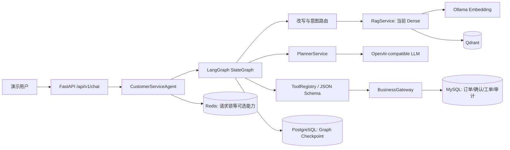
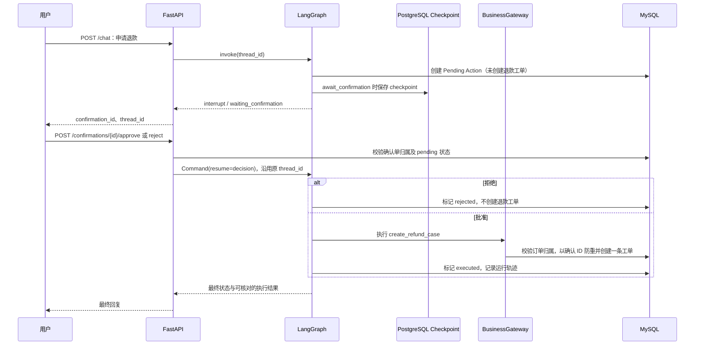

# Enterprise Customer Service Agent V2

基于开源仓库的企业售后 Agent 二次开发与本地演示项目。用户可咨询售后知识、查询模拟订单，并申请创建**退款售后工单**；写入前必须经过人工确认。这里没有真实支付退款，也未在生产环境上线。

## 已验证的范围

- FastAPI → LangGraph → 真实 OpenAI-compatible LLM → Planner / Tool Calling → 本地 MySQL 业务工具；多轮会话、订单查询和退款申请闭环已有本地证据。
- Markdown 知识入库、Ollama 中文 Embedding、Qdrant **Dense** 检索及知识问答；当前虽然配置 `RETRIEVAL_MODE=hybrid`，但 `OPENSEARCH_ENABLED=false`，不是已验证的 Hybrid RAG。
- 退款 Pending Action → LangGraph `interrupt` → 拒绝/批准 → PostgreSQL Checkpoint 恢复 → MySQL 售后工单；同一确认单重复批准返回 409，固定复测中未重复创建工单。
- MCP、OpenSearch/BM25、Milvus、Reranker、LangSmith/OTel 等有代码或可选配置，但**不在本次本地验收范围**。常驻演示服务 `SECURITY_ENABLED=false`；JWT/租户边界仅在隔离测试进程中验证。

## 架构与调用链



入口为 [`create_app`](src/customer_service_app/main.py)、[`chat`](src/customer_service_app/api/routes_chat.py)；门面 [`CustomerServiceAgent`](src/customer_service_app/services/customer_service_agent.py) 调用 [`CustomerServiceGraphRuntime`](src/customer_service_app/workflows/runtime.py)。图和节点见 [`customer_service_graph.py`](src/customer_service_app/workflows/customer_service_graph.py)、[`nodes.py`](src/customer_service_app/workflows/nodes.py)。`PlannerService` 生成并校验有限计划；简单问题可由模型直接 Tool Calling。`ToolRegistry` 校验 JSON 参数和工具超时，`BusinessGateway` 在业务写入边界核对订单归属。

PostgreSQL 保存可恢复的 Graph 线程状态；MySQL 保存订单、Pending Action、退款申请工单及 Agent Run。两库**不共享事务**，因此确认级幂等不等于跨所有故障窗口的全局 exactly-once。



## 本地快速复现

需要 Docker/Compose、Python 3.11 镜像、有效的 OpenAI-compatible 聊天模型 API，以及本地 Ollama Embedding 模型。仅在**本地合成数据环境**使用；不要暴露 8000 端口到公网。若 `.env` 尚不存在，可参考 [`.env.example`](.env.example) 新建并手动填写密钥；绝不覆盖已有 `.env`、提交密钥或把它打印到日志。当前验证配置为 `gpt-5.6-terra` 中转 API、`qllama/bge-small-zh-v1.5:q8_0`（512 维）、Qdrant、PostgreSQL Checkpoint；模型名称不是硬性依赖，Embedding 维度必须与向量集合一致。

下面是**已有镜像和数据库的快速路径**，在仓库内的 Ubuntu-22.04 WSL Shell 执行：

```bash
docker compose --profile durable --profile embedding up -d mysql redis qdrant checkpoint-postgres ollama
docker compose -f docker-compose.yml -f docker-compose.p0.yml up -d --no-deps --no-build app
curl -fsS http://127.0.0.1:8000/health/live
curl -fsS http://127.0.0.1:8000/health/ready
```

`/health/ready` 只核对关键**配置是否填写**，不证明 MySQL、Qdrant 或模型 API 实际连通。若 Ollama 卷中无模型，需单独拉取；这一步可能下载较大镜像/模型。现有可运行环境使用 `docker-compose.p0.yml` 只读挂载当前源码；**干净 Docker Build 和全新环境重建尚未验收**。此外，当前工作区的 `docker-compose.yml` 有未提交的本地端口/Profile/Ollama 调整，单靠 Git HEAD 不能复刻该运行状态。具体配置、测试和安全边界见 [运行与演示说明](reports/p3_demo_2026-10-22.md)。

## 验证证据与项目归属

P2.1 结束时自动测试为 `153 passed, 3 skipped`。固定 40 例的最终合并自动结果为 28 Pass、2 Fail、10 待人工复核；人工核对后为 **37 Pass、2 Fail、1 Partial**。其中 34 例走本地 API 网络 runner，4 例为隔离 JWT/Mock 身份测试，2 例为 Mock 故障测试；37/40 **不是**纯真实模型成功率、稳定生产成功率或 SLA。有效知识题 18 例的 Dense Hit@5 为 0.6667、MRR 为 0.6111；题集口径和回答忠实性另见报告。

本仓库原有 FastAPI/LangGraph/RAG/工具体系；本地增量贡献集中于退款确认缺陷修复、订单归属与确认级幂等、Graph 快照授权、意图路由与 Planner 来源追踪、固定集评测和证据链。不要把整体架构写成个人从零实现。详见 [贡献与证据](reports/p3_contributions_2026-10-22.md)、[P2.1 完整报告](reports/p2_1_agent_optimization_2026-10-22.md)、[源码学习导航](reports/p3_source_study_2026-10-22.md)。

已知限制：模拟业务数据、常驻鉴权关闭、无真实支付退款、无跨库原子事务、MCP/OpenSearch 未启用、干净构建未验证；C05 工具选择和 K01 回答完整性仍是已记录的 Bad Case。License 见仓库原有 [LICENSE](LICENSE)。
