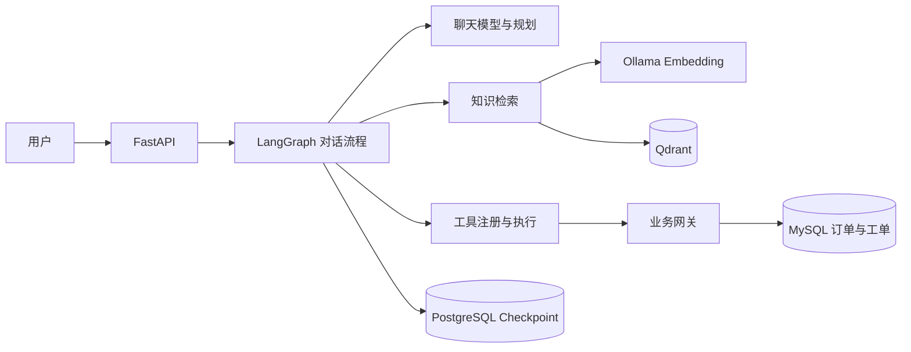

# 企业售后智能体

这是基于 [enterprise-customer-service-agent-v2](https://github.com/iwcdoit/enterprise-customer-service-agent-v2) 的二次开发与本地验证项目。它把售后知识问答、模拟订单查询和退款申请接入同一条 Agent 业务链路：模型理解请求，检索知识或调用业务工具；涉及写入时先等待人工确认，再恢复执行。这里的“退款”仅指**创建售后申请工单**，不执行支付退款。

## 核心能力

- **多轮对话与工具调用：** FastAPI 接收请求，LangGraph 维护会话状态，真实聊天模型选择知识查询、订单查询等工具。
- **中文知识问答：** Markdown 文档经本地 Ollama Embedding 入库 Qdrant，回答可以核对检索来源。当前实际验证的是 Dense 检索。
- **受控售后写入：** 退款申请进入待确认状态；拒绝不创建工单，批准后由 Checkpoint 恢复执行，同一确认单重复批准不会再次写入。
- **可追踪的结果：** 对话响应、Agent Run、图线程状态、确认单和 MySQL 业务记录可交叉核对，而不只依赖模型回复。

## 系统结构

主要代码入口：[FastAPI](src/customer_service_app/main.py) → [对话接口](src/customer_service_app/api/routes_chat.py) → [Agent 门面](src/customer_service_app/services/customer_service_agent.py) → [图运行时](src/customer_service_app/workflows/runtime.py)与[节点](src/customer_service_app/workflows/nodes.py)。模型规划由 [PlannerService](src/customer_service_app/services/planner_service.py) 负责；工具参数与执行入口见 [ToolRegistry](src/customer_service_app/services/tool_registry.py)，业务归属和写入检查见 [BusinessGateway](src/customer_service_app/services/business_gateway.py)。

退款申请的关键顺序是：**识别写入意图 → 创建待确认动作并中断图 → 用户批准或拒绝 → 从 PostgreSQL Checkpoint 恢复 → 校验订单归属并创建工单 → 记录结果**。拒绝分支不会创建工单；重复批准同一确认单返回冲突。详细的 HTTP、图状态与数据库对照见[本地演示指南](reports/p3_demo_2026-10-22.md)。

## 本地运行

运行需要 Python 3.11、Docker Compose、可用的 OpenAI-compatible 聊天模型 API，以及 MySQL、Redis、PostgreSQL、Qdrant 和 Ollama。参考 [`.env.example`](.env.example) 配置模型接口和服务地址；**不要提交 `.env` 或在日志中打印密钥**。已验证的中文 Embedding 模型为 `qllama/bge-small-zh-v1.5:q8_0`，向量维度为 512。

[运行与演示指南](reports/p3_demo_2026-10-22.md)给出了现有本地环境的启动、健康检查、模拟订单准备和退款确认步骤。请注意：仓库快照尚未完成“从全新镜像和空数据库一键部署”的验收，不能把已有环境的启动命令当作干净部署保证。`/health/ready` 也只检查配置，不代表外部服务均已连通。

## 验证结果

| 验证内容 | 本地记录 |
|---|---|
| 现有自动测试 | 153 通过、3 跳过 |
| 固定业务场景 | 40 例中，经人工核对 37 通过、2 失败、1 部分通过 |
| 中文知识检索 | 18 个有效知识问题，Dense Hit@5 为 0.6667、MRR 为 0.6111 |
| 退款申请闭环 | 拒绝不写入；批准创建 1 条模拟工单；同一确认单重复批准返回 409；跨 API 重启可恢复 |

40 例包含 34 个本地 API 场景、4 个隔离身份验证场景和 2 个模拟故障场景，**不是 40 次纯真实模型调用**，也不能据此宣称稳定生产成功率。完整判定与失败案例见[业务场景评测](reports/p2_1_agent_optimization_2026-10-22.md)和[知识检索评测](reports/p2_1_rag_2026-10-22.md)。

## 项目来源与当前边界

FastAPI、LangGraph、RAG 和业务工具的基础结构来自原开源项目。本仓库的增量工作主要是退款确认链路修复、订单归属与确认级幂等、图状态访问控制、意图路由优化，以及可复核的业务评测。具体改动和源码入口见[二次开发记录](reports/p3_contributions_2026-10-22.md)与[源码学习导航](reports/p3_source_study_2026-10-22.md)。

目前使用模拟订单；本地常驻服务未开启鉴权，MCP 和 OpenSearch 未启用，MySQL 与 PostgreSQL 之间也没有跨库原子事务。本项目是本地工程验证，不是生产上线案例。许可证沿用原仓库的 [LICENSE](LICENSE)。
