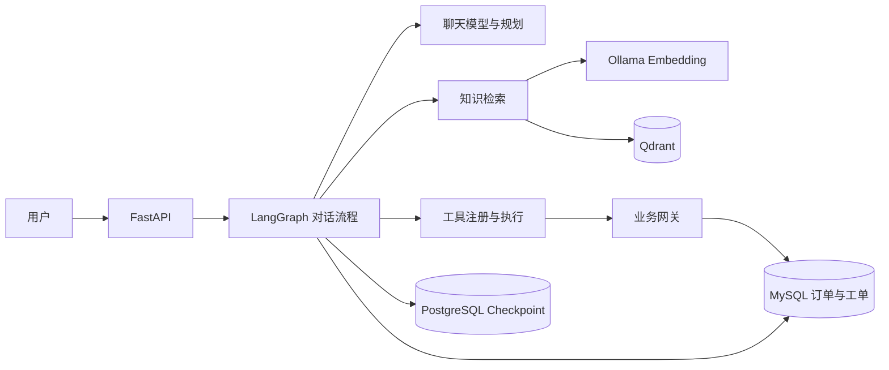

# 企业售后智能体

基于 [enterprise-customer-service-agent-v2](https://github.com/iwcdoit/enterprise-customer-service-agent-v2) 二次开发的售后 Agent 项目。系统将真实大模型、LangGraph 编排、中文知识检索和订单工具串成完整业务链路，支持从多轮咨询、订单查询到**退款申请工单**的受控创建。

## 项目亮点

- **真实模型驱动的 Agent：** 通过 OpenAI-compatible API 接入聊天模型，结合 Planner 与 Tool Calling 完成多步业务请求，并保留执行轨迹。
- **本地中文知识检索：** 使用 Ollama Embedding 与 Qdrant 检索售后政策，回答可回溯知识来源。
- **人工确认与状态恢复：** 退款申请先进入 Pending Action；批准或拒绝后，LangGraph 从 PostgreSQL Checkpoint 恢复执行。
- **可靠的业务写入边界：** MySQL 写入前校验订单归属，使用确认单标识防止同一申请重复创建工单。
- **固定场景验证：** 覆盖业务对话、工具调用、人工确认、身份边界与故障处理，并保留 HTTP、Trace 和数据库对照证据。

## 系统架构



请求由 [FastAPI 对话接口](src/customer_service_app/api/routes_chat.py)进入 [Agent](src/customer_service_app/services/customer_service_agent.py)；[LangGraph 节点](src/customer_service_app/workflows/nodes.py)负责检索、规划、执行与确认路由。工具执行和业务写入分别由 [ToolRegistry](src/customer_service_app/services/tool_registry.py)、[BusinessGateway](src/customer_service_app/services/business_gateway.py)承接。

### 退款申请闭环

用户提出申请 → Agent 查询订单与规则 → 创建待确认动作并中断 → 人工批准或拒绝 → 恢复原对话线程 → 校验订单归属并创建工单 → 留存运行轨迹。拒绝分支不写入工单；重复批准同一确认单返回 409。完整演示步骤见[本地演示指南](reports/p3_demo_2026-10-22.md)。

## 项目结构

```text
src/customer_service_app/  API、LangGraph、RAG、工具和业务服务
knowledge_base/           售后政策与业务知识文档
scripts/                  知识入库、模拟数据准备和评测脚本
evals/                    固定业务与检索测试集
tests/                    自动化回归测试
reports/                  运行轨迹、评测结果与验收记录
```

## 运行与演示

准备 Python 3.11、Docker Compose、MySQL、Redis、PostgreSQL、Qdrant，以及可用的 OpenAI-compatible 聊天模型 API。参考 [`.env.example`](.env.example) 配置本地 `.env`；中文向量模型使用 Ollama 的 `qllama/bge-small-zh-v1.5:q8_0`（512 维）。

[运行与演示指南](reports/p3_demo_2026-10-22.md)提供现有本地环境的服务启动、健康检查、模拟订单和退款确认步骤，也可以按其中的三个场景做 5 分钟演示。首次准备知识库可查看[文档入库脚本](scripts/ingest_docs.py)。

## 验证结果

| 验证内容 | 本地记录 |
|---|---|
| 自动化回归 | 153 项通过，3 项跳过 |
| 固定业务与可靠性场景 | 40 例，复核后 37 例通过（92.5%）、2 例失败、1 例部分通过；包含真实模型接入的在线业务测试 |
| 中文知识检索 | 18 个有效知识问题，Dense Hit@5 为 0.6667、MRR 为 0.6111 |
| 退款申请闭环 | 拒绝不创建工单；批准创建 1 条模拟工单；重复批准返回 409；跨 API 重启可恢复 |

评测问题、判定依据、模型调用轨迹和失败案例见[业务场景评测](reports/p2_1_agent_optimization_2026-10-22.md)与[知识检索评测](reports/p2_1_rag_2026-10-22.md)。

## 二次开发与说明

本仓库沿用原项目的 FastAPI、LangGraph、RAG 和业务工具基础，重点完善退款确认闭环、订单归属校验、确认级幂等、图状态访问控制、意图路由和可复核评测。具体改动见[二次开发记录](reports/p3_contributions_2026-10-22.md)与[源码学习导航](reports/p3_source_study_2026-10-22.md)。

演示数据为模拟订单，“退款”指提交售后申请工单。演示配置用于可信本地环境；对外部署前应开启鉴权、替换示例口令并管理好模型密钥。许可证沿用原仓库的 [LICENSE](LICENSE)。
